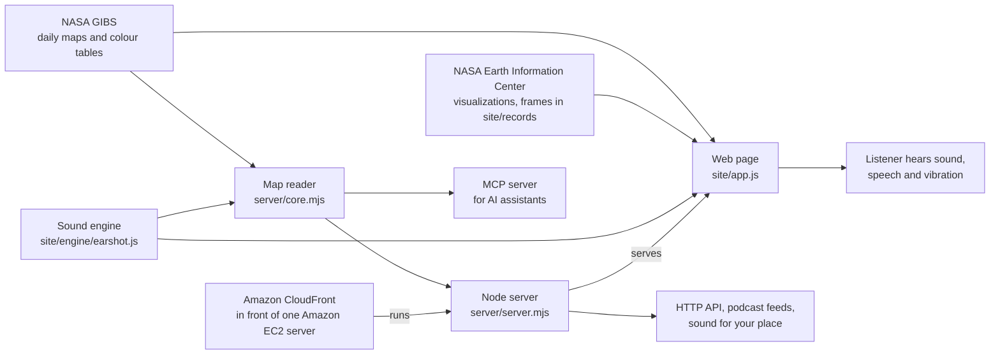

# Earshot

**NASA's Earth maps you can hear, for people who are blind or have low vision.**

By Team USV for the 2026 NASA Space Apps Challenge (Charlotte), challenge "The Earth Information Jukebox".

| | |
|---|---|
| Live site | <https://dp16xommhs4bv.cloudfront.net> |
| Demo video (29 seconds) | <https://dp16xommhs4bv.cloudfront.net/demo.html> |
| Seven slides | <https://dp16xommhs4bv.cloudfront.net/slides.html> |
| Teachers' guide | <https://dp16xommhs4bv.cloudfront.net/teachers.html> |
| Daily podcast feed | <https://dp16xommhs4bv.cloudfront.net/feed.xml> |

Everything is free, needs no account, and runs in any modern browser.

## The problem

NASA shows the state of our planet as pictures: smoke, haze, rain, sea temperature, the lights of our cities. A person who cannot see the picture is left out. In Charlotte alone about 28,000 people are blind or have serious difficulty seeing even with glasses, and 8.6 million across the United States (US Census Bureau, 2024). Worldwide, about 43 million people are blind and 295 million more have moderate or severe vision impairment (The Lancet Global Health, 2021).

Earshot turns those NASA maps into sound that can be read by ear, and says the important parts in plain words.

## How to listen

Three rules, and one sound for missing data:

1. **Low notes are the south of the planet, high notes the north.** Each voice is one band of latitude.
2. **The sound travels from west to east,** from your left ear to your right.
3. **Louder and brighter means more** smoke, haze, rain, heat or light.
4. **A soft hiss means no data** in that slice of the map (for example land, on a map of the sea).

## What it does

- **A jukebox of NASA maps.** Visualizations from NASA's Earth Information Center: night lights from 2012 to 2023, ocean currents through a year, four kinds of aerosol, lightning through a year and fine particles (PM2.5). And NASA's newest day of rain, smoke and dust, haze and sea temperature, fetched live from NASA's map service. Each record has its own instrument.
- **Change over time.** "Play all 12 in order" plays every year or month in turn at one shared volume, then says what changed. "Hear only what changed" plays just the rise between the first and last moment: silent where nothing changed, loud where it grew most.
- **Easier listening.** Four voices by default, one band at a time when you want only one sound to follow, or all eight. You can pick another instrument if you find it easier.
- **It speaks.** A short briefing, a description of what the picture looks like, and the value over any city, all written by fixed rules from the numbers. The page voice is optional, so it does not talk over a screen reader.
- **Explore by keyboard, touch or mouse.** Arrow keys move over the map and each spot plays a tone; Enter says the place and its value. Phones that support it also vibrate.
- **Is it smoky, hazy or raining near me?** Type a city. Earshot plays the area around it (about 6,000 by 3,000 kilometres), rings a soft chime as the sound passes your place, then says the reading there and how far away and in which direction the most is.
- **A listening check.** Three NASA maps play without the picture; you answer simple questions and your score is compared with the right answers worked out from the data.
- **Your own data.** Drop in a world map picture, a CSV table of places and values, or an Earshot sound file. It is read in your browser and sent nowhere.
- **A sound that is also a map.** Every sound file Earshot writes carries a small note (title, unit, scale, source). Drop it back in and Earshot rebuilds the map from the sound.
- **Comes to you every day.** A podcast feed for your own place, for example `/api/v1/feed.xml?place=Charlotte`, with the words written under each episode. The files are WAV, which some podcast apps (Apple Podcasts among them) cannot play yet.
- **Play the whole jukebox** in a loop, for a speaker beside a screen such as the Earth Information Center wall.
- **For classes.** A twenty-minute lesson plan for teachers, which students who are blind, have low vision or see well can do together.
- **For developers and AI assistants.** An HTTP API with free keys, and an MCP server so AI assistants can read NASA's maps too.

## How it works

1. **Read the number behind each colour.** For NASA's daily maps (GIBS), Earshot reads each pixel's colour through NASA's own published colour table, so it gets the real value (for example degrees Celsius or millimetres an hour), not a guess. For the Earth Information Center visualizations, it matches each colour to the colour bar NASA printed with them.
2. **Make a grid.** The map becomes 8 bands of latitude by 72 slices of longitude, each holding a value or "no data".
3. **Play it.** Each band is a voice, tuned so any mix sounds pleasant. The sound sweeps west to east; a band's value sets how loud and how bright its voice is. Missing data becomes a hiss.
4. **Check it.** A second program is given only the sound and rebuilds the map from it. The match between that rebuilt map and the real one is shown on the page for every record, so nobody has to take the sound on trust.

### Architecture



The same engine file runs in the browser, the server and the MCP server, so all three make exactly the same sound. If NASA's map service cannot be reached, a saved day in `site/records/live/` keeps the site working.

## The research it is built on

Sound maps and sonified data have been studied with blind, low-vision and sighted listeners for many years. Earshot follows what those studies found.

| Finding | Source | What Earshot does |
|---|---|---|
| Seven blind users completed 95 percent of geography tasks with a sound map that combined a sweep, speech and keyboard exploring, against 33 percent with a spreadsheet | Zhao and others, 2008 | Offers a sweep, a spoken briefing and keyboard exploring together |
| 35 people, 20 of them blind, explored sound maps by keyboard or tablet and then picked the matching tactile map with high accuracy, with no difference between groups | Delogu and others, 2010 | Lets you explore one point at a time by keys or touch |
| 45 legally blind listeners and sighted listeners agreed closely on which way a sound should change as a value rises | Walker and Mauney, 2010 | Uses one mapping for everyone |
| "Attending to three or more continuous streams of sonified data is extremely difficult" | Flowers, 2005 | Starts with four voices instead of eight, and can play one band at a time |
| "Patterned or modulated streams will help keep them separate" | Flowers, 2005 | Gives each voice its own slow shimmer |
| Loudness is "a poor auditory dimension" for exact values | Neuhoff, 2011 | Makes a fuller voice brighter as well as louder, and always gives the numbers in words |
| Only one of seven blind users consciously used left and right | Zhao and others, 2008 | Uses time as the main west-to-east cue, with left and right as support |
| 3,184 survey participants, sighted and blind or low-vision, reported learning gains from NASA's sonifications | Arcand and others, 2024 | Brings the same approach to NASA's Earth maps |
| Few sonification projects publish a measured check of their sound | Zanella and others, 2022 | Shows a machine check for every map, and a listening check anyone can take |

## Earlier work, and what is new

NASA already turns pictures into sound (for example "Caldwell 73", SVS 13786, and the Chandra "Universe of Sound" project). "Planetary Bands, Warming World" (2015) gave each band of latitude its own instrument. Arcobaleno, a 2023 Space Apps global winner, turned the colours of NASA images into music for people with sight impairments.

Earshot adds five things: it reads the real number behind each colour from NASA's own colour tables; it checks every sound against its map; it plays the area around your own place every day and says how far away and which way the most is; it writes sound files that turn back into maps; and it lets you hear only what changed.

## Run it yourself

Needs Node.js 18 or newer. There is nothing to install.

```
node server/server.mjs
```

Then open <http://localhost:8790>. Set the `PORT` environment variable to use another port. (`npm start` does the same.)

The site also works as plain static files: put `site/` on any static host. Then the API panel says it is not running, the listening check keeps its count on the device, and everything else works.

## Testing

```
npm test
```

This runs `test/roundtrip.test.mjs`, 50 checks with no network needed. They turn known maps into sound and back, and check that the values come back, that colours decode to the right numbers, that sound files keep their note, that CSV tables and the area around a place are read correctly, and that "what changed" and "one band at a time" behave as described.

Anyone can also check the sound by ear on the live site: open "Can you hear the map?" and take the listening check.

Two helper scripts need the internet: `node test/fetch-fallback.mjs 2026-11-13` saves one day of each live NASA layer into `site/records/live/`, and `test/layers.probe.mjs` reports how well a NASA layer decodes and plays back.

## API and MCP

The API lives under `/api/v1/` on the same server.

```
# What can be read (no key needed)
curl https://dp16xommhs4bv.cloudfront.net/api/v1/records

# Today's haze around Charlotte as a sound file (no key needed)
curl -o haze.wav "https://dp16xommhs4bv.cloudfront.net/api/v1/audio/haze.wav?place=Charlotte"

# A free key, then a plain-language briefing for one place
curl -X POST https://dp16xommhs4bv.cloudfront.net/api/v1/keys
curl -X POST https://dp16xommhs4bv.cloudfront.net/api/v1/brief \
  -H "Authorization: Bearer <your key>" -H "content-type: application/json" \
  -d '{"record":"smoke","place":"Charlotte"}'
```

`POST /api/v1/sonify` turns a NASA record or your own grid of values into a WAV file, with the self-check result.

The MCP server gives AI assistants four tools: `list_records`, `describe_map`, `value_at` and `sonify_map`. Add it to an assistant like this:

```
{ "mcpServers": { "earshot": { "command": "node", "args": ["mcp/earshot-mcp.mjs"] } } }
```

## What is in this repository

| Path | What it holds |
|---|---|
| `site/` | The website: `index.html`, `styles.css`, `app.js`, the slides, the demo page and the teachers' guide |
| `site/engine/earshot.js` | The sound engine. One file, no dependencies |
| `site/data/` | The records, the city list and the text of every information button |
| `site/records/` | Frames of NASA visualizations, and one saved day of each daily layer |
| `server/` | The HTTP server, API and feeds, and a small PNG reader |
| `mcp/` | The MCP server |
| `test/` | The checks and the two helper scripts |
| `tools/` | The two scripts that built the demo video from NASA frames and the engine's sound |
| `docs/DESIGN.md` | The technical design in more detail |

## NASA data used

Earth Information Center visualizations, from NASA's Scientific Visualization Studio (SVS):

| Record | NASA visualization | How it is read |
|---|---|---|
| Night lights, 2012 to 2023 | "Change in Night Lights between 2012 and 2023", SVS 5313, NASA Black Marble. Visualization by Kel Elkins. <https://svs.gsfc.nasa.gov/5313/> | Brightness, 12 frames, one a year |
| Ocean currents | "Global Sea Surface Currents and Temperature", SVS 3912, ECCO2 model. Animation by Greg Shirah, Horace Mitchell and Eric Sokolowsky. <https://svs.gsfc.nasa.gov/3912/> | Temperature from NASA's colour bar, 12 frames, one a month |
| Aerosols, four kinds | "GEOS Aerosols (2025)", SVS 5669. Visualization by Joseph V. Ardizzone and Helen-Nicole Kostis. <https://svs.gsfc.nasa.gov/5669/> | Dust, smoke, sulfate and sea salt from the legend colours; relative values |
| Lightning through a year | "Lightning Events Detected from the International Space Station 2017-2023", SVS 5011. Visualization by Michala Garrison, Greg Shirah, Kel Elkins and Alex Kekesi. <https://svs.gsfc.nasa.gov/5011/> | Lightning marks counted per cell, 12 frames |
| Fine particles | "Particulate Matter (PM) 2.5", SVS 5151, GEOS-CF model. <https://svs.gsfc.nasa.gov/5151/> | Colours matched to NASA's colour bar |

Daily layers from NASA's Global Imagery Browse Services (GIBS), <https://gibs.earthdata.nasa.gov>, read through NASA's own colour tables:

| Record | NASA product |
|---|---|
| Rain | IMERG precipitation rate (Global Precipitation Measurement mission) |
| Smoke and dust | OMPS Nadir Mapper aerosol index on NOAA-21 |
| Haze | VIIRS Deep Blue aerosol optical depth on NOAA-20 |
| Sea temperature | GHRSST MUR sea surface temperature |
| Coastlines (for the area map) | Coastlines 15m |

Every daily map also links to the same layer and day in NASA Worldview. Some visualizations in the challenge brief were not used because NASA publishes no flat whole-world frame of them; the reasons are listed in `site/data/eic.js`.

## References

- Zhao, Plaisant, Shneiderman and Lazar, "Data Sonification for Users with Visual Impairment: A Case Study with Georeferenced Data", ACM Transactions on Computer-Human Interaction 15(1), 2008. <https://doi.org/10.1145/1352782.1352786>
- Delogu, Palmiero, Federici, Plaisant, Zhao and Belardinelli, "Non-visual exploration of geographic maps: Does sonification help?", Disability and Rehabilitation: Assistive Technology 5(3), 2010. <https://doi.org/10.3109/17483100903100277>
- Walker and Mauney, "Universal Design of Auditory Graphs: A Comparison of Sonification Mappings for Visually Impaired and Sighted Listeners", ACM Transactions on Accessible Computing 2(3), 2010. <https://doi.org/10.1145/1714458.1714459>
- Flowers, "Thirteen years of reflection on auditory graphing: promises, pitfalls, and potential new directions", Proceedings of ICAD 2005. <https://www.icad.org/Proceedings/2005/Flowers2005.pdf>
- Hermann, Hunt and Neuhoff (editors), The Sonification Handbook, Logos, Berlin, 2011, chapter 4 by Neuhoff. <https://sonification.de/handbook/>
- Arcand, Schonhut-Stasik, Kane, Sturdevant, Russo, Watzke, Hsu and Smith, "A Universe of Sound: processing NASA data into sonifications to explore participant response", Frontiers in Communication 9, 2024. <https://doi.org/10.3389/fcomm.2024.1288896>
- Zanella and others, "Sonification and Sound Design for Astronomy Research, Education and Public Engagement", Nature Astronomy, 2022. <https://arxiv.org/abs/2206.13536>
- GBD 2019 Blindness and Vision Impairment Collaborators, "Trends in prevalence of blindness and distance and near vision impairment over 30 years", The Lancet Global Health 9(2), e130 to e143, 2021. <https://doi.org/10.1016/S2214-109X(20)30425-3>
- US Census Bureau, American Community Survey 2024 (1-year), table B18103, "Sex by age by vision difficulty": Charlotte city 28,282 (margin of error 3,565); United States 8,592,859. Read through Census Reporter. <https://censusreporter.org/data/table/?table=B18103&geo_ids=16000US3712000,01000US>
- NASA Scientific Visualization Studio, "Data Sonification: Caldwell 73" (SVS 13786), 2020. <https://svs.gsfc.nasa.gov/13786/>
- St. George, Crawford and others, "Making Climate Data Sing: Using Music-like Sonifications to Convey a Key Climate Record", Bulletin of the American Meteorological Society, 2017. <https://journals.ametsoc.org/bams/article/98/1/23/69577/>
- NASA, "2023 NASA International Space Apps Challenge announces 10 global winners" (Arcobaleno, Global Connection award). <https://science.nasa.gov/directorates/smd/2023-nasa-international-space-apps-challenge-announces-10-global-winners/>
- Typeface: Outfit, SIL Open Font License 1.1, loaded from Google Fonts. No other third-party code is used.

## Use of AI

An AI assistant (Claude, by Anthropic, through Claude Code) was used heavily in this project. It researched the challenge, earlier work and past winners; it proposed technical approaches, including the eight latitude voices and the self-check; and it wrote most of the code, the text on the site, the slides and the video script.

The team made the decisions that shape the project:

- which challenge to answer, choosing the Earth Information Jukebox;
- who it is for: people who are blind or have low vision, and hazard information they cannot get from a picture;
- that it should tell each person about the area where they live, every day;
- that it must accept people's own data, and be offered to other developers through an API with keys;
- that the design would rest on published research with blind listeners;
- where it is hosted, and what stayed in the final version.

Every AI suggestion was a proposal that the team accepted, changed or rejected.

No image, video or audio in this project was made by generative AI. Every sound is computed from NASA data by the formulas in `site/engine/earshot.js`, and no AI model runs inside the product. The demo video's narration is a standard computer voice. Every source file carries a note at the top saying it was written with AI assistance.

## Licence

Apache License 2.0 (see `LICENSE` and `NOTICE`). NASA data and imagery are in the public domain. Earshot is not made or endorsed by NASA.
